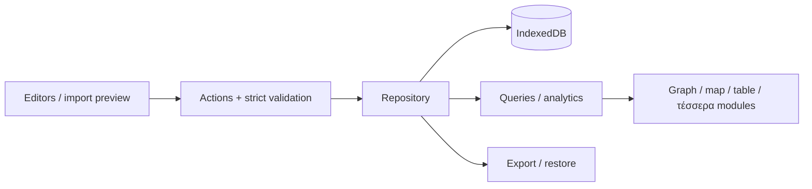

# Αρχιτεκτονική — υπάρχον και σχεδιαζόμενο

## Υπάρχουσα δομή κώδικα

```text
src/core/types.ts                  Portable TypeScript contracts, όχι runtime storage
src/core/validate.mjs              Καθαρή συνάρτηση validateWorkspace -> error strings[]
data/fixtures/workspace.demo.json  Synthetic workspace v1, ontologyVersion/revision
scripts/validate.mjs               JSON read + domain validation + CLI exit code
tests/domain.test.mjs              20 Node tests του validator
package.json                      Node >=24, npm test και npm run validate
```

Εκτελέσιμη σημερινή ροή: fixture JSON → validateWorkspace → errors ή CLI success.
Δεν υπάρχουν εξωτερικές npm εξαρτήσεις, frontend, network calls ή database.
Τα TypeScript types δεν επιβάλλουν runtime validation και ο validator δεν καλύπτει
ακόμη κάθε πιθανό malformed input/unknown field. Αυστηρό boundary parsing είναι M1.

## Κοινό domain model

EntityType/RelationshipType/PropertyDefinition είναι δεδομένα. Entity και edge
έχουν σταθερά IDs. Facts αναφέρονται σε entity ή edge, με typed value, evidence,
validity, status, basis και createdAt. Μετρήσεις annual στο αρχικό format.
Sources δηλώνουν provenance και demo/real mode. Corrections χρησιμοποιούν
supersedesId και κρατούν παλιές εκδόσεις. SavedView κρατά παραμετρικό path query,
αλλά το query engine δεν υπάρχει ακόμη. Bindings συνδέουν semantic roles των modules
με IDs definitions. Format version, ontology version και workspace revision διαφέρουν.

## Προτεινόμενη πλήρης PoC ροή



React + TypeScript + Vite, Dexie, Zod, MapLibre, Recharts, Cytoscape.js είναι
προτεινόμενες εξαρτήσεις προς επαλήθευση/εγκατάσταση στο αντίστοιχο milestone.
Όχι προεγκατεστημένες βιβλιοθήκες. Lockfile και TypeScript/build setup στο M1.

Προτεινόμενα layers: core (domain/actions/queries), storage (repository/adapter),
ui (generic editors/inspector), modules (θεματικές προβολές), analytics, connectors.
Components δεν γράφουν απευθείας στη βάση. Νέος entity type δεν δημιουργεί νέο store.
Μία συναλλαγή αλλάζει workspace, revision και history μαζί. expectedRevision
ελέγχεται μέσα στη συναλλαγή για αποφυγή χαμένων ενημερώσεων από tabs.

## Όρια και invariants

- Νέοι τύποι/property/relation δουλεύουν στις generic φόρμες χωρίς νέο component.
- Κοινά entities και query services, όχι ανεξάρτητα per-module datasets.
- Typed numeric units και περίοδοι. Όχι source mixing ή αυτόματη μετατροπή currency.
- Υποθέσεις δεν μπαίνουν εξ ορισμού σε factual rankings. Coverage/conflicts ορατά.
- Validity φίλτρα σε κάθε βήμα graph. Cycles, result limits και truncation ελεγχόμενα.
- IndexedDB ανά browser/origin, όχι sync ή backup. M2 απαιτεί export/restore.
- Πραγματικά user datasets/exports και credentials δεν μπαίνουν αυτόματα στο Git.

Backend προστίθεται μόνο για τεκμηριωμένες ανάγκες κοινής πρόσβασης/μεγάλου όγκου/jobs,
μέσω repository adapter με ίδιους domain IDs. Prediction/simulation απαιτούν ξεχωριστά
μοντέλα και evaluation, δεν προκύπτουν από τις ακμές του graph.

Αναλυτικά: `docs/ARCHITECTURE.md`, `docs/ONTOLOGY.md`, `docs/OPERATIONS.md`.
Συγχρόνισε αυτή τη σύνοψη και τα σχετικά specs όταν αλλάζει contract ή αρχιτεκτονική.
