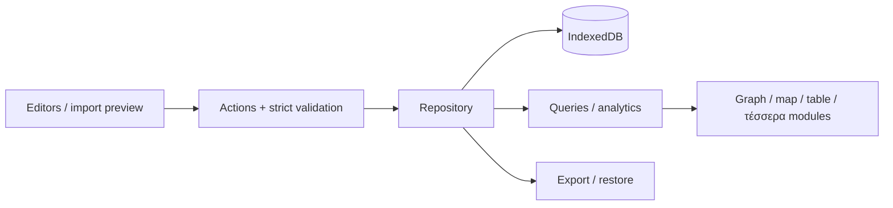

# Αρχιτεκτονική — υπάρχον και σχεδιαζόμενο

## Υπάρχουσα δομή κώδικα

```text
src/core/types.ts                  Portable contracts
src/core/validate.mjs              Semantic validator, χωρίς npm dependency
src/core/parse.ts                  Strict boundary: unknown fields, depth/size, IDs
src/core/actions.ts                Actions, revision bump, typed errors, role bindings
src/core/import.ts                 CSV preview, exact match, import key
src/core/query.ts                  Path, compare, rank
src/core/transfer.ts               Export envelope and unknown format rejection
src/core/undo.ts                   Inverse action and dependency guard
src/real/                          Cited real extract, separate from the demo
src/storage/                       Repository, memory backend, Dexie adapter
src/ui/                            Greek shell, generic editors, import/export
data/fixtures/workspace.demo.json  Synthetic workspace v1
data/real/                         Retrieved public extracts and the real workspace
tests/                             Domain, parser, actions, storage, transfer
tests/browser/                     Playwright acceptance
```

Εκτελέσιμη ροή: φόρμα ή αρχείο → action/preview → strict parse + semantic
validation → μία IndexedDB transaction με workspace, action id και history.
Ο domain πυρήνας δεν εισάγει React ή Dexie. Το history και τα idempotency
records μένουν έξω από το workspace document, ώστε το fixture v1 να παραμένει
έγκυρο. Το export envelope τα ενώνει.

## Κοινό domain model

EntityType/RelationshipType/PropertyDefinition είναι δεδομένα. Entity και edge
έχουν σταθερά IDs. Facts αναφέρονται σε entity ή edge, με typed value, evidence,
validity, status, basis και createdAt. Προαιρετικό `confidence` στις ακμές και
στα facts είναι `high`, `medium` ή `low`. Μετρήσεις annual στο αρχικό format.
Sources δηλώνουν provenance και demo/real mode. Corrections χρησιμοποιούν
supersedesId και κρατούν παλιές εκδόσεις. SavedView κρατά παραμετρικό path query
και το `src/core/query.ts` το εκτελεί. Bindings συνδέουν semantic roles των modules
με IDs definitions. Format version, ontology version και workspace revision διαφέρουν.

## Προτεινόμενη πλήρης PoC ροή



React + TypeScript + Vite, Dexie, Zod, MapLibre, Recharts, Cytoscape.js είναι
προτεινόμενες εξαρτήσεις προς επαλήθευση/εγκατάσταση στο αντίστοιχο milestone.
Όχι προεγκατεστημένες βιβλιοθήκες. Lockfile και TypeScript/build setup στο M1.

Προτεινόμενα layers: core (domain/actions/queries), storage (repository/adapter),
ui (generic editors/inspector), modules (θεματικές προβολές), analytics, connectors.
Components δεν γράφουν απευθείας στη βάση. Νέος entity type δεν δημιουργεί νέο store.
Μία συναλλαγή αλλάζει workspace, revision και history μαζί. expectedRevision
ελέγχεται μέσα στη συναλλαγή για αποφυγή χαμένων ενημερώσεων από tabs.

## Όρια και invariants

- Νέοι τύποι/property/relation δουλεύουν στις generic φόρμες χωρίς νέο component.
- Κοινά entities και query services, όχι ανεξάρτητα per-module datasets.
- Typed numeric units και περίοδοι. Όχι source mixing ή αυτόματη μετατροπή currency.
- Υποθέσεις δεν μπαίνουν εξ ορισμού σε factual rankings. Coverage/conflicts ορατά.
- Validity φίλτρα σε κάθε βήμα graph. Cycles, result limits και truncation ελεγχόμενα.
- IndexedDB ανά browser/origin, όχι sync ή backup. M2 απαιτεί export/restore.
- Πραγματικά user datasets/exports και credentials δεν μπαίνουν αυτόματα στο Git.

Backend προστίθεται μόνο για τεκμηριωμένες ανάγκες κοινής πρόσβασης/μεγάλου όγκου/jobs,
μέσω repository adapter με ίδιους domain IDs. Prediction/simulation απαιτούν ξεχωριστά
μοντέλα και evaluation, δεν προκύπτουν από τις ακμές του graph.

Αναλυτικά: `docs/ARCHITECTURE.md`, `docs/ONTOLOGY.md`, `docs/OPERATIONS.md`.
Συγχρόνισε αυτή τη σύνοψη και τα σχετικά specs όταν αλλάζει contract ή αρχιτεκτονική.
