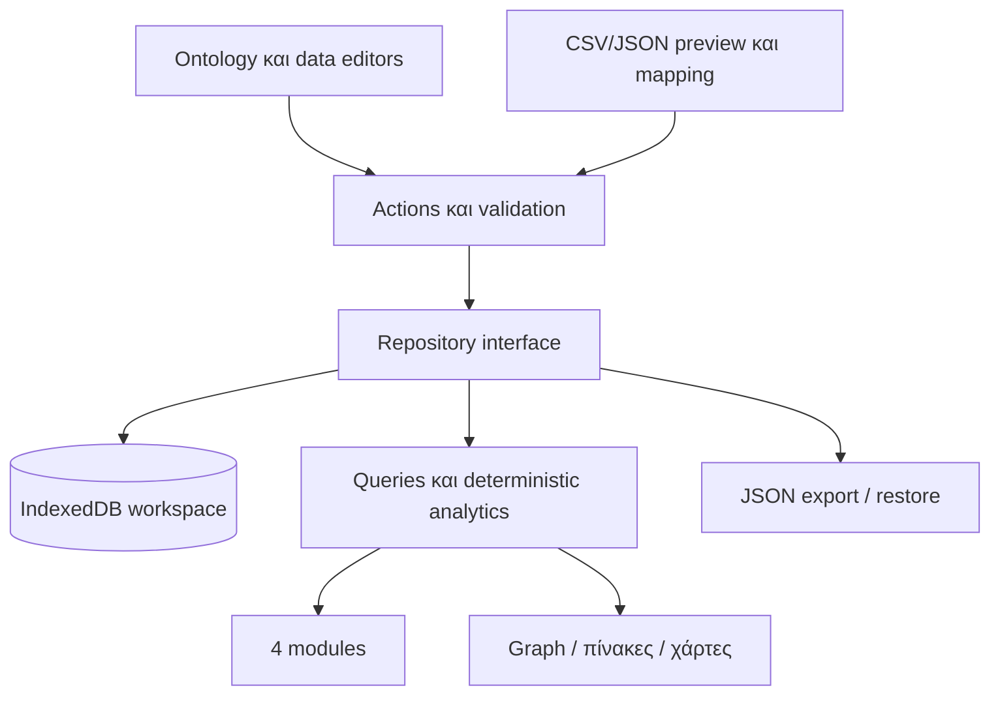

# Αρχιτεκτονική του browser PoC

## Προτεινόμενη απόφαση για αυτό το πακέτο

React + TypeScript + Vite. IndexedDB μέσω Dexie για τοπική αποθήκευση, Zod για
runtime δομές, MapLibre GL JS για χάρτες, Recharts για χρονοσειρές, Cytoscape.js
για graph. Οι εκδόσεις και άδειες ελέγχονται/κλειδώνονται στο M1, δεν υποτίθενται
ήδη εγκατεστημένες. Κανένα API key χρειάζεται για τον offline πυρήνα.

Επιλέγουμε browser-only αρχικά αντί υποχρεωτικού Python server: οικονομικότερο
στήσιμο και άμεση δοκιμή του editor. Ο domain πυρήνας δεν εξαρτάται από React,
Dexie ή βιβλιοθήκη γραφημάτων. Η επιλογή είναι τεχνική πρόταση του σχεδίου,
όχι ιστορική απόφαση του χρήστη. Μπορεί να αλλάξει πριν την υλοποίηση με αιτιολόγηση.

## Στρώματα και αρχεία που θα συμπληρωθούν

- src/core/: types, validation, actions, queries, import mapping. Καθαρή λογική.
- src/storage/: repository interface, Dexie adapter, atomic transactions/migrations.
- src/ui/: shell, generic editors, inspector και error/empty states.
- src/modules/: οι τέσσερις εφαρμογές με δηλωμένες role bindings.
- src/analytics/: εκτελέσιμα templates με input constraints και provenance.
- src/connectors/: μόνο μετά το M5, ελεγμένοι adapters και source cards.

Repository: loadWorkspace, commitAction(expectedRevision, action), exportSnapshot,
restoreIntoNewWorkspace. Τα components δεν γράφουν απευθείας IndexedDB.
Μία workspace transaction αλλάζει δεδομένα, revision και history μαζί.
Το ID ενός τύπου είναι δεδομένο. Δεν αντιστοιχεί σε νέο IndexedDB table κάθε φορά.
Τα stores είναι γενικά: metadata, ontology, entities, relationships, facts, sources,
views, changeLog, importJobs. Έτσι νέοι τύποι δεν απαιτούν DB migration.

## Αποθήκευση και περιορισμοί

Προσωπική χρήση, ένας ενεργός writer ανά workspace. expectedRevision έλεγχος σε
transaction αποκλείει χαμένες ενημερώσεις από δεύτερο tab. Conflict σημαίνει reload
και επανάληψη, όχι last-write-wins. Αυτόματη αποθήκευση μετά από έγκυρο action,
όχι μετά από κάθε keystroke. Browser quota/transaction failure αφήνει προηγούμενη
κατάσταση και το UI δείχνει ότι οι αλλαγές δεν αποθηκεύτηκαν.

IndexedDB αποθηκεύει στο συγκεκριμένο browser profile και origin. Δεν συγχρονίζει
συσκευές και μπορεί να καθαριστεί από τον browser. JSON export και restore είναι
υποχρεωτικά πριν από πραγματική χρήση. Κανένα workspace δεν ανεβαίνει αυτόματα σε
hosting/Drive. Demo και real workspaces ξεχωρίζουν αυστηρά.

Για deployment αρκεί static frontend χωρίς backend data hosting. Η IndexedDB δεν
είναι δημόσια online βάση. Αλλαγή origin αλλάζει και τον χώρο αποθήκευσης.
Δεν γίνεται serverless deployment της παλιάς SQLite βάσης ως persistent storage.

## Όταν δικαιολογηθεί backend

Μεγάλα datasets, scheduled fetches/CORS, πολλοί χρήστες ή κοινός χώρος εργασίας:
Python/FastAPI + PostgreSQL, μέσω repository/transport adapter και ίδιων IDs.
Ο server επαναλαμβάνει validation, permissions και concurrency checks. Browser
validation μόνο του δεν αρκεί για shared API. SQLite μπορεί να χρησιμοποιηθεί
σε προσωπικό local backend αν χρειαστεί· δεν είναι υποχρεωτικό μέρος του PoC.
NetworkX/graph DB προστίθενται μετά από profiling πραγματικών queries.

Αρχικός στόχος μέτρησης: 5k entities, 10k edges, 50k facts, 2-hop γειτονιά <1s
στο δηλωμένο test machine, γραφική προβολή έως 200 nodes/500 edges με truncation.
Δεν έχει μετρηθεί ακόμη. Queries έως 4 hops/1000 results εκτός graph renderer.
Για μεγαλύτερη κλίμακα κάνουμε profiling πριν αλλάξουμε υποδομή.
